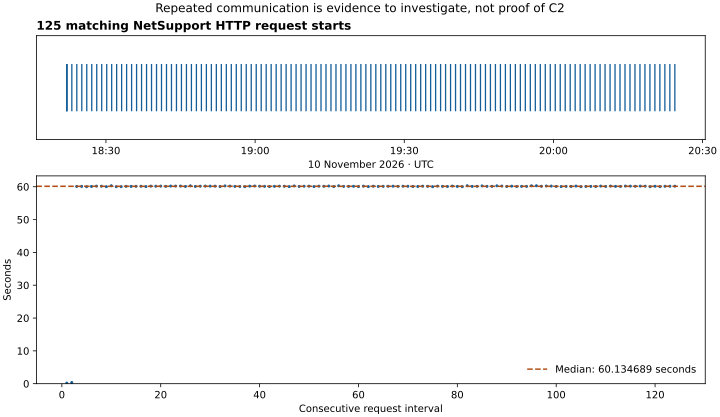

# Network intrusion investigation

A packet-based investigation of suspected unauthorized NetSupport remote access, using a November 2026 training capture. Built by Kingsley Eze as a SOC portfolio case.

The investigation traces host identity, scripted retrieval and readable HTTP on TCP port 443. It separates source alert context, packet observations and conclusions that still need endpoint evidence.

## Review in five minutes

1. Read the [incident report](docs/INCIDENT_REPORT.md) for findings and response decisions.
2. Inspect the [key frame index](evidence/key_frames.json), [evidence JSON](evidence/analysis.json) or the CSV files in `evidence/`. Every observation retains the original frame number and UTC time.
3. Read the [detection specification](detections/SPECIFICATION.md) and [test coverage](docs/VALIDATION.md).
4. Use the [reproduction guide](docs/REPRODUCE.md) to obtain the source capture and rerun the analysis.
5. Practice the [interview walkthrough](docs/INTERVIEW.md) using the evidence, not memorized claims.

## Results

| Measure | Observed |
| --- | ---: |
| Capture frames | 30,182 |
| Packet-local HTTP requests | 139 |
| Matching remote-support triage requests | 125 |
| Median matching-request interval | 60.134689 seconds |
| Synthetic boundary tests | 20 passed |

First matching request: frame 24675, 2026-11-10 18:22:07.728744 UTC. The first TCP connection packet is frame 24672 at 18:22:07.509531 UTC. Reporting both avoids confusing connection start with application activity.



The two short initial intervals are retained rather than removed to make the timing appear more regular. [Plot script](scripts/plot_cadence.py) requires matplotlib, an optional reporting dependency.

## Tools and evidence limits

Executed: Python 3.12.14, dpkt 1.9.8, hashlib, unittest and offline packet inspection. The custom extractor is deliberately limited to Ethernet classic PCAP, IPv4 and packet-local protocol fields. It does not reassemble TCP or decrypt TLS. It is not a replacement for a full network sensor.

Wireshark/TShark review instructions are supplied for independent verification. TShark 4.6.4 independently verified the key HTTP packet and total frame count on the hosted runner. The initial local runtime lacked installation privileges. See the [recorded result](evidence/tshark-validation.json). Zeek and Suricata are not claimed as executed.

The capture is a public training case from Brad Duncan / Malware-Traffic-Analysis.net. The prompt already identified the NetSupport alert endpoint, so this is not a blind family-identification benchmark. No source answer page was consulted. Raw captures and payload objects are not redistributed. No malicious object was executed.

## Quick run

```bash
python3 -m venv .venv
. .venv/bin/activate
python3 -m pip install -r requirements.txt
python3 -m unittest discover -s tests -v
python3 scripts/fetch_capture.py
python3 scripts/analyze.py source/2026-11-10-traffic-analysis-exercise.pcap --out rerun
python3 scripts/verify_case.py rerun/analysis.json
```

No cloud subscription, payment card or live victim system is required. Retrieval contacts the original capture provider only. Analysis makes no network requests.

## Status

Local analysis and all 20 tests passed. Both [hosted validation jobs](https://github.com/kinz0042/network-intrusion-investigation/actions/runs/43712913614) passed: synthetic cases, saved-evidence assertions, hash-pinned capture retrieval, byte-identical regeneration and independent TShark verification of the key HTTP frame and frame count. Publication approved. All validation results and evidence limits are recorded below.

[Source and provenance](evidence/provenance.json) · [Reproduction](docs/REPRODUCE.md) · [Incident report](docs/INCIDENT_REPORT.md)
